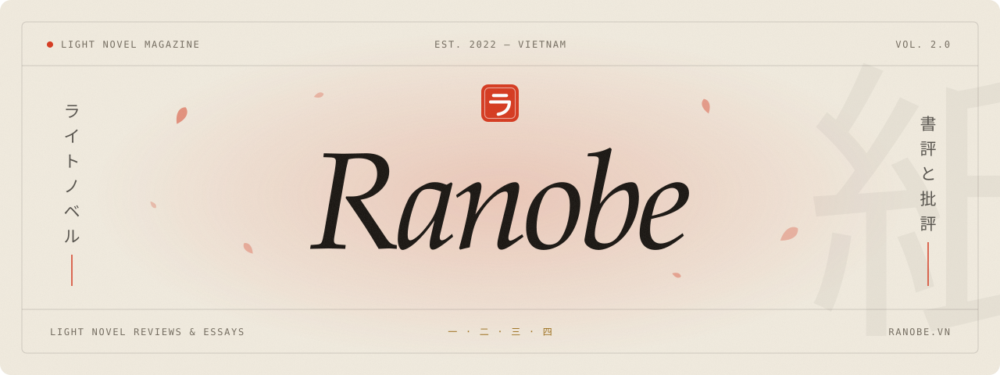
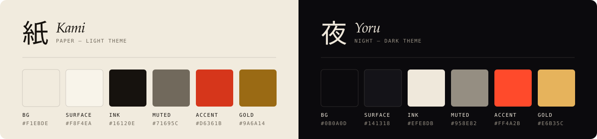

<a href="https://ranobe.vn">
  <picture>
    <source media="(prefers-color-scheme: dark)" srcset=".github/assets/banner-dark.svg">
    
  </picture>
</a>

 
 

**A Vietnamese light novel magazine.** 
Reviews, essays and side stories on modern Japanese fiction

 

 

## 一 &nbsp; About

**Ranobe** (ラノベ) has been writing about light novels since 2022. Version 2.0 rebuilds the site as a printed magazine: ivory paper, black ink, a single vermilion seal, Japanese running down the margins.

Every post is an MDX file in this repo. No database, no backend.

 

## 二 &nbsp; Highlights

- **WebGL cover ring**: the twelve latest covers orbit the hero, with hand-written GLSL shaders.
- **Sakura splash**: falling petals, once per session.
- **`Ctrl` `K` search**: full-text and accent-insensitive, including Japanese titles and romaji.
- **Reading view**: cover wipe, parallax, reading progress and a series info card.
- **Built-in CMS**: Keystatic at `/keystatic` writes straight to MDX.

 

## 三 &nbsp; Design

  

 

Two themes, one set of tokens: **Kami** (紙, paper) and **Yoru** (夜, night). Set in Fraunces, Literata, Be Vietnam Pro, JetBrains Mono and Shippori Mincho.

 

ラノベ &nbsp;·&nbsp; Est. 2022 / Vietnam

